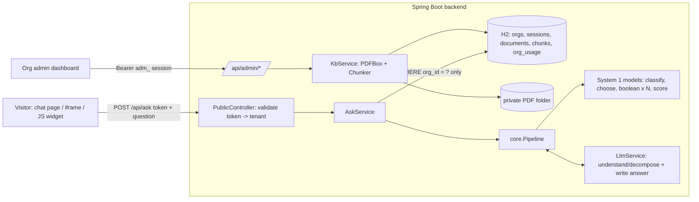

# AI Knowledge & Decision Assistant (Java 17 + Spring Boot)

Organizations sign up, upload up to 10 PDFs, and get a private, embeddable assistant that answers visitor questions **only from their own documents**, with page-level references.

The core idea: **the LLM is used only for language; small "System 1" decision models make the actual decisions; application code orchestrates and combines them.**

## 1. Setup

**Prerequisites:** JDK 17+ and Maven 3.8+ (or open the folder in IntelliJ / Eclipse / VS Code as a Maven project). No database server needed: it uses an embedded H2 file database.

```bash
mvn spring-boot:run                      # http://localhost:8080
# or:  mvn package && java -jar target/knowledge-assistant-1.0.0.jar
```

Optional configuration: copy `.env.example` to `.env` (never commit it). The app reads it automatically.

| Variable | Purpose | Default |
|---|---|---|
| `ANTHROPIC_API_KEY` | Enables the LLM for question understanding and answer writing. **Optional**: without it the app runs end to end on a deterministic offline fallback. | empty |
| `LLM_MODEL` | Anthropic model name | `claude-sonnet-5-5` |
| `PUBLIC_BASE_URL` | Base URL used in the assistant/embed URLs you copy from the dashboard | `http://localhost:8080` |
| `DATA_DIR` | H2 database + private uploaded PDFs | `./data` |

**Load the demo data (2 organizations, 3 PDFs each) and build the embed page** (run from the project root):

```bash
mvn spring-boot:run -Dspring-boot.run.arguments=--app.seed-demo=true
# jar version:  java -jar target/knowledge-assistant-1.0.0.jar --app.seed-demo=true
```

This registers the two sample organizations, uploads `sample_data/pdfs/<org>/*.pdf`, and writes `demo/embed_demo.html`. **Open that file directly in your browser** (it is an external page that embeds both assistants). Demo logins (password `Passw0rd!x`): `admin@greenfield.example`, `admin@zenith.example`.

**Run the tests:** `mvn test`

## 2. Project layout

```
src/main/java/com/example/assistant
├── core/        PURE JAVA, no Spring: the whole AI/decision logic
│   ├── Pipeline.java        orchestration: retrieve → classify → choose → understand → decide (parallel) → combine → answer
│   ├── Decisions.java       System 1 models: QuestionClassifier, PolicyChooser, CriterionEvaluator, SupportScorer
│   ├── Understanding.java   offline fact extraction + rule (criteria) extraction
│   ├── Chunker.java         heading-aware chunking with page numbers
│   ├── Bm25Index.java       per-organization BM25 retrieval + relevance score
│   ├── Answerer.java        offline (extractive) answer writer
│   └── LlmClient.java       the interface the LLM sits behind
├── service/     Spring services: AuthService, KbService (PDFBox), LlmService (Anthropic API), AskService, DemoSeeder
└── web/         REST controllers, admin-auth interceptor, error handler
src/main/resources  static UI (dashboard.html, chat.html, embed.js), schema.sql, application.properties
sample_data/        6 sample PDFs (2 organizations) + test_questions.json
demo/               embed_demo.template.html (embed_demo.html is generated by the seeder)
```

Keeping `core/` free of Spring is deliberate: the decision logic can be unit-tested without a web server or database, and the LLM is swappable behind `LlmClient`.

## 3. Architecture



**Question flow (`core/Pipeline.java`)**

```
token -> organization -> that org's chunks only -> BM25 retrieve -> [S1] classify -> [S1] choose policy section
      -> [LLM] understand: facts + criteria -> [S1, parallel] one Boolean per criterion
      -> [app] combine -> [S1] score -> [LLM] write answer -> answer + references
```

| Layer | Responsibility | Where |
|---|---|---|
| **LLM** | (1) *Understand/decompose*: extract the visitor's facts (GPA, year…) and the machine-checkable rules from the retrieved policy text as JSON. (2) *Write* the friendly final answer from the decisions + context. It never decides eligibility. | `LlmService`, `LlmClient` |
| **System 1 models** | Small, fast, deterministic, independent. **Classification** (question type), **Choice** (which policy section governs), **Boolean** (is each condition met? one per condition, run in parallel on a thread pool), **Score** (how well the policy supports the outcome). | `core/Decisions.java` |
| **Application logic** | Tenant resolution, retrieval, routing, parallel execution, combining (ALL conditions must hold → `ELIGIBLE`; any failure → `NOT_ELIGIBLE`; missing facts → `NEED_MORE_INFO`), error handling, usage counters. | `core/Pipeline.java`, `service/AskService.java` |

**Why this split:** eligibility is a *logic* problem, not a text-generation problem. LLMs read messy language well but are unreliable at consistently applying `GPA >= 3.5 AND year >= 2 AND NOT sports_scholarship`. Here the same inputs always give the same decision, every condition is individually auditable ("holds a sports scholarship: you said yes; the policy requires no → NOT met"), and the LLM cannot hallucinate an approval. If a fact is missing, the assistant asks for it instead of guessing.

**Worked example:** *"I'm a 2nd year student with a 3.6 GPA and I already hold a sports scholarship. Can I get the merit scholarship?"*

1. Token → Greenfield University; only Greenfield's chunks are loaded and indexed.
2. Classification → `eligibility` (personal facts + eligibility cue). Choice → "Merit Scholarship, Scholarship_Rules.pdf p.2" (it beats "Sports Scholarship" because its heading matches the thing being asked for).
3. Understanding → facts `{gpa: 3.6, year: 2, has_sports_scholarship: true}`; criteria `gpa >= 3.5`, `year >= 2`, `sports_scholarship == false`.
4. Three Boolean models run **in parallel** → met, met, NOT met.
5. Application logic combines → `NOT_ELIGIBLE`; Score → policy-support confidence.
6. Answer written with the reference `Scholarship_Rules.pdf — Page 2`.

The chat UI has a "How was this decided?" panel that shows the step trace and every decision, which is handy for the demo.

**LLM vs. offline mode.** With `ANTHROPIC_API_KEY` set, steps 3 and 6 use the LLM. Without a key, or if the call fails, times out or returns bad JSON, the pipeline falls back to a deterministic rule extractor and an extractive answer writer, and the response `notes` field says so. The System 1 layer is identical in both modes.

## 4. Knowledge base

* **Validation** (`KbService.validateAndExtract`): `.pdf` extension, `%PDF` header, ≤ 10 MB, ≤ 20 pages, ≤ 10 documents per organization, not password-protected, readable, has extractable text. Each failure returns a specific message. Uploading the same filename **replaces** the old version.
* **Extraction:** Apache PDFBox, page by page. Scanned/image-only PDFs are rejected with a clear message (no OCR in the MVP).
* **Chunking:** heading-aware. Sections (numbered or Title-Case headings) become chunks; long sections are split into ~130-word sentence windows with a 1-sentence overlap. Each chunk stores document, page and heading, and never spans pages, so page references stay exact.
* **Retrieval:** BM25 (heading counted double) over *only the calling organization's chunks*. A relevance score (IDF-weighted share of the question's meaningful terms found in the chunk) below `0.35` makes the assistant say the knowledge base doesn't contain the answer and count the question as "unable to answer / human review". Questions where most terms appear nowhere in the organization's documents are also treated as "not in the knowledge base".
* **References:** every answer returns `document`, `page`, `section` and a snippet (e.g. `Scholarship_Rules.pdf — Page 2`). The application builds them from the chunks actually used, never the LLM, and unanswerable questions show none.

## 5. Security & tenant isolation

* **Two separate credential types.** Admin session tokens (`adm_…`, stored as SHA-256 hashes, 24 h expiry) are accepted only under `/api/admin/*` (enforced by `AdminAuthInterceptor`). Assistant tokens (`ast_…`, 192-bit random, carrying no credentials or content) are accepted only by `/api/ask` and `/api/assistant/{token}`. An assistant token sent as a Bearer credential is rejected, and an admin token is rejected as an assistant token (both tested).
* **Passwords:** PBKDF2-HMAC-SHA256 (120k iterations) with a per-user salt, compared in constant time.
* **Isolation is enforced in the data layer:** every tenant row carries `org_id`; `KbService.loadChunks` queries `WHERE c.org_id = ? AND d.org_id = ?` and only that list is ever passed to the index, the decision models and the LLM prompt. Admin routes always scope by the session's organization (deleting another organization's document returns 404).
* **Private documents:** PDFs are stored under `DATA_DIR/uploads/<orgId>/<random>.pdf`, which no route serves, and there is no download endpoint. Original filenames are sanitized.
* **Token management:** "Regenerate" replaces the token and the old URL stops working immediately.
* **Isolation tests:** `PipelineQuestionsTest` (core) and `ApiSecurityTest` (full HTTP stack). The Zenith assistant is asked about scholarships/hostels and the Greenfield assistant about returns/warranty; both answer "not in knowledge base" with zero references. A sweep also checks that every reference returned to each organization belongs to its own files.

## 6. API

| Method & path | Auth | Purpose |
|---|---|---|
| `POST /api/auth/register` `{org_name,email,password}` | none | Create organization + session |
| `POST /api/auth/login`, `POST /api/auth/logout` | none / admin | Session |
| `GET /api/admin/me` | admin | Organization name + limits |
| `GET /api/admin/documents` | admin | List knowledge-base documents |
| `POST /api/admin/documents` (multipart `file`) | admin | Upload / replace a PDF |
| `DELETE /api/admin/documents/{id}` | admin | Delete a PDF (and its chunks) |
| `GET /api/admin/assistant` | admin | Assistant URL, iframe + script embed code |
| `POST /api/admin/assistant/regenerate` | admin | New token; old one is disabled |
| `GET /api/admin/usage` | admin | asked / answered / unable-to-answer |
| `GET /a/{token}` | public | Chat page (static shell, no document content) |
| `GET /api/assistant/{token}` | public | Organization display name (validates the token) |
| `POST /api/ask` `{token,question}` | assistant token | Run the pipeline |

`POST /api/ask` returns `{answer, answered, outcome, question_type, references[], decisions[], trace[], notes[], llm_used}`, where `outcome` is one of `ANSWERED | ELIGIBLE | NOT_ELIGIBLE | NEED_MORE_INFO | NO_KNOWLEDGE`.

## 7. Error handling

Invalid, corrupt, fake, encrypted or scanned PDF; size, page and document limits; duplicate-name replacement; processing failure (the stored file is rolled back with the database rows); invalid token (401); empty or too-long question (400); no relevant knowledge (clear "not in knowledge base" plus a human-review count); LLM failure (automatic offline fallback plus a note); decision-model failure (isolated per criterion; the result is downgraded and a note is added); unexpected server error (generic message, counted in `org_usage.errors`, details only in the server log). All errors are returned as `{"detail": "..."}`.

## 8. Test data & tests

* `sample_data/pdfs/`: **Greenfield University** (Scholarship_Rules, Admissions_FAQ, Hostel_Policy) and **Zenith Electronics** (Returns_and_Refund_Policy, Warranty_Policy, Shipping_Guide).
* `sample_data/test_questions.json`: 23 questions covering direct info, policy, procedural, **multi-condition** (G5, G6, Z2, Z3), **multiple structured decisions** (G7 income + GPA; Z4 months + liquid-damage exclusion), missing info (G8), comparison (G9, Z5), **not in the knowledge base** (G10, G11, Z8) and cross-tenant probes (I1–I4).
* `src/test/.../core/*Test.java`: run all 23 questions through the real pipeline, plus chunker tests and LLM-path tests with a fake provider (LLM failure fallback, decision-model failure).
* `src/test/.../web/ApiSecurityTest.java`: full-stack tests through the REST API with real PDF uploads (authentication, token swapping, isolation, upload limits, replace/delete, regenerate, logout, usage counters).

## 9. Known limitations & production improvements

* **Offline rule extraction is pattern-based** (GPA, year, income, days/months, receipt, damage, scholarship holding, liquid damage) and tuned to the style of the sample policies. With the LLM enabled, criteria extraction generalizes to any attribute; the Boolean models are generic (`>= > <= < == !=`, numbers and booleans).
* Boolean models evaluate conditions from the chosen section plus sibling "Exclusions / Conditions / Eligibility" sections of the same document. Rules spread across several documents are not merged.
* Retrieval is lexical BM25 (no embeddings), so synonyms ("refund" vs "money back") can miss. Production: hybrid BM25 + embeddings with a reranker and a per-tenant vector namespace.
* "System 1" here means rule/threshold models behind a clean interface (`core/Decisions.java`); they can be replaced by a trained classifier or a decision-table engine (e.g. Laya) without changing the pipeline.
* The index is rebuilt in memory for every question (fine for ≤ 200 pages per organization). Production: cache per organization and invalidate on upload.
* Auth is deliberately simple (no email verification, password reset or rate limiting). Assistant tokens are stored in plaintext so the dashboard can re-display the URL. Production would add rate limiting, per-assistant allowed-origin lists and abuse monitoring on `/api/ask`.
* In personal-story questions, words that appear nowhere in the documents are ignored when judging relevance, so an unrelated personal question that shares a generic word with the documents could be answered loosely. A production system would add an LLM relevance check.
* No OCR, no conversation memory (each question is independent), English only, single-node H2 (switch to MySQL/PostgreSQL by changing the datasource properties; `schema.sql` is plain SQL).
"# ai-knowledge-decision-assistant" 
